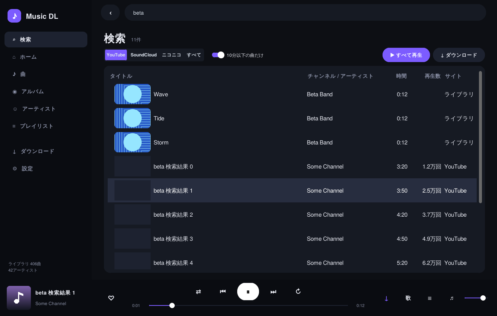
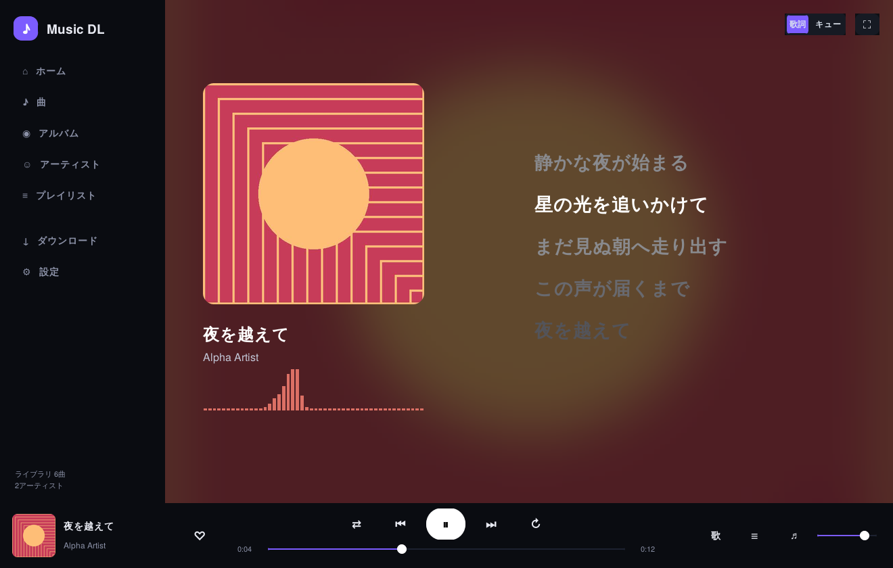
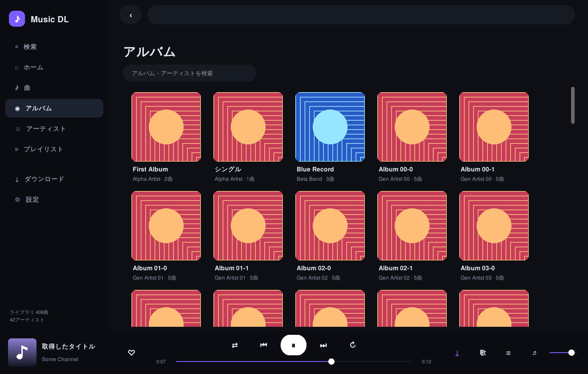

# Music DL

YouTube などから**検索してそのまま再生**でき、気に入った曲は**ワンクリックでダウンロード**できる、デスクトップ用の音楽プレーヤー兼ダウンローダーです。
Python 1ファイル(`music_dl.py`)で動きます。

<p align="center">
  
</p>

## 主な機能

**検索 → 再生 → ダウンロード**
- 画面上部の検索欄(`Ctrl+K`)から、YouTube / SoundCloud / ニコニコ を横断検索
- 検索結果をダブルクリックで、ダウンロードせずにストリーミング再生(次の曲は先読み)
- 再生中の曲を「↓」ボタンでそのままダウンロード(M4A / MP3 / FLAC / OPUS / WAV、動画はMP4)
- URL を貼ればそのまま再生。プレイリスト丸ごとの取得、サムネイル・タグ埋め込みにも対応

**音楽プレーヤー**
- ライブラリ(曲 / アルバム / アーティスト / プレイリスト / お気に入り / 最近再生)
- 同期歌詞(`.lrc`・埋め込み歌詞・[LRCLIB](https://lrclib.net) からの取得)
- ビジュアライザー、ジャケットをぼかした再生中画面、キュー、シャッフル / リピート
- ショートカット: `Space` 再生/停止、`←` `→` 5秒移動、`Ctrl+←` `Ctrl+→` 前後の曲、`F11` 全画面

<p align="center">
  
  
</p>

**設定ページ**
- yt-dlp のバージョン確認・更新(安定版 / ナイトリー)
- Deno(YouTube に必要な JavaScript ランタイム)のワンクリック導入
- FFmpeg の導入(winget / Homebrew)、同時DL数・速度制限・プロキシ・Cookie、アクセントカラー、出力デバイスなど

## 必要なもの
- Python 3.9 以上
- [FFmpeg](https://ffmpeg.org/)(Windows: `winget install ffmpeg` / 設定ページからも導入できます)
- Linux は PortAudio(`sudo apt install libportaudio2`)と tkinter(`sudo apt install python3-tk`)

## 使い方
```bash
git clone https://github.com/Foxy8928/chiller.git
cd chiller
pip install -r requirements.txt   # 省略しても、初回起動時に自動で入ります
python music_dl.py
```

YouTube で検索・ダウンロードに失敗するときは、**設定 > ツール** で yt-dlp の更新と Deno のインストールを行ってください。

## データの保存場所
| 内容 | 場所 |
|---|---|
| ダウンロードした音楽 | 設定した保存先の `Music/`(既定: `~/Downloads/MusicDL`) |
| 設定 | `~/.music_dl_settings.json` |
| ライブラリ索引・お気に入り・歌詞/画像キャッシュ・Deno | `~/.music_dl/` |

## 外部への通信について
- 検索・再生・ダウンロード: yt-dlp が各サイトへ接続します
- 歌詞の取得(LRCLIB)/ アーティスト画像の取得(Deezer): 曲名・アーティスト名を送信します。**設定でそれぞれオフにできます**
- 更新確認: PyPI(yt-dlp の最新版)

## 注意
- 自分が権利を持つ、またはダウンロードが許可されているコンテンツにのみ使用してください。各サービスの利用規約と、お住まいの国・地域の法律に従ってください。
- Spotify / Apple Music / Amazon Music など DRM で保護された配信サービスには対応していません。
- 本ソフトは現状有姿で提供され、利用によって生じた問題について作者は責任を負いません。

## 使っているライブラリ
[yt-dlp](https://github.com/yt-dlp/yt-dlp) / [FFmpeg](https://ffmpeg.org/) / [CustomTkinter](https://github.com/TomSchimansky/CustomTkinter) / [mutagen](https://github.com/quodlibet/mutagen) / [Pillow](https://python-pillow.org/) / [NumPy](https://numpy.org/) / [sounddevice](https://python-sounddevice.readthedocs.io/) / [Deno](https://deno.com/)

## ライセンス
[MIT](LICENSE)
